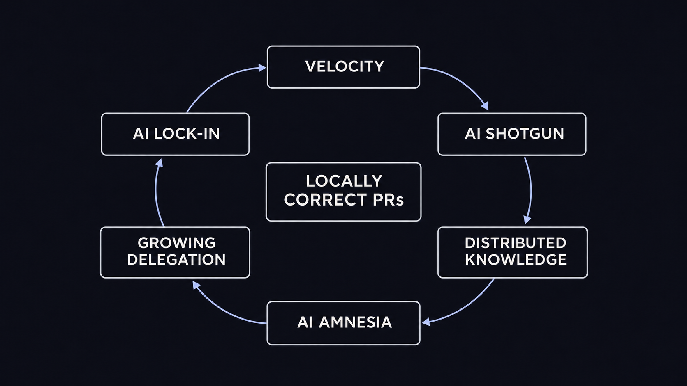
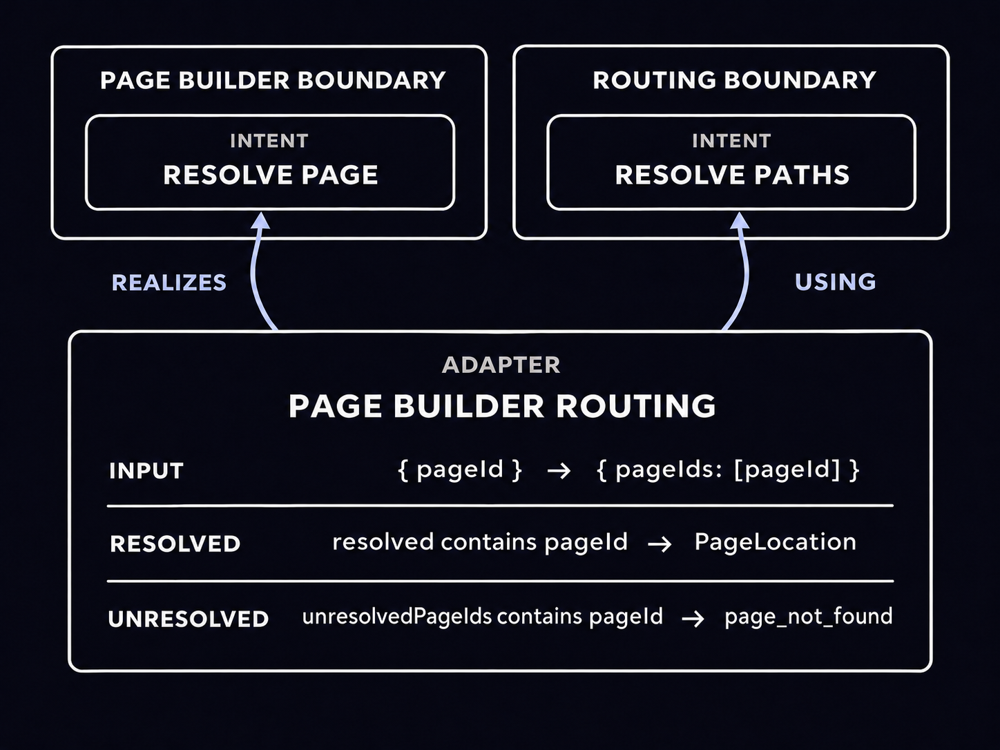
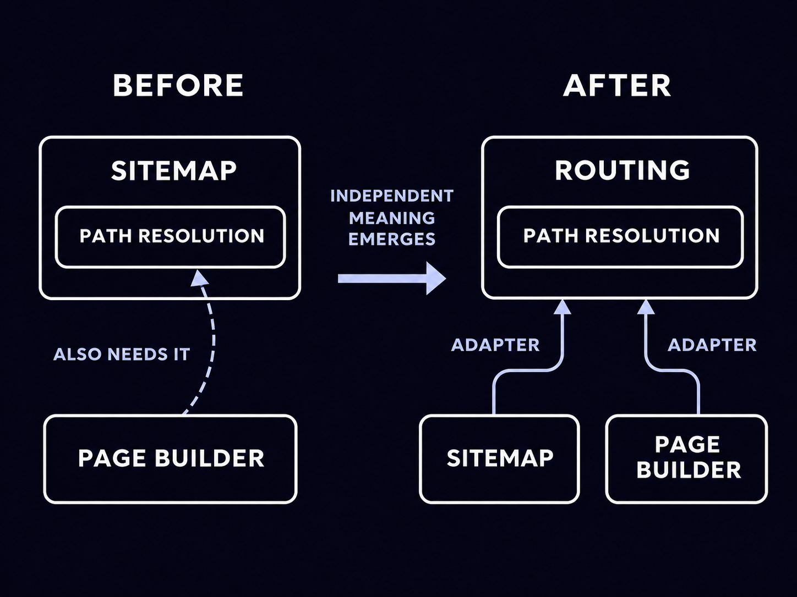
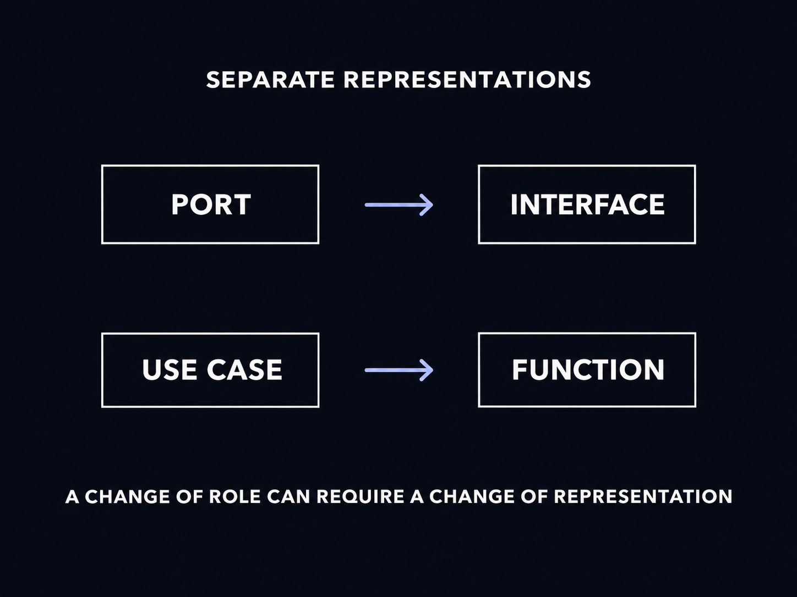
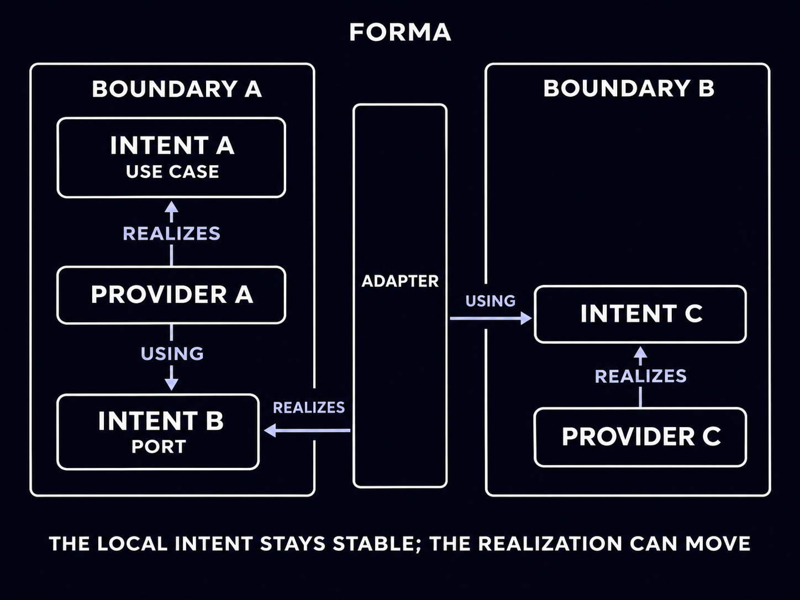
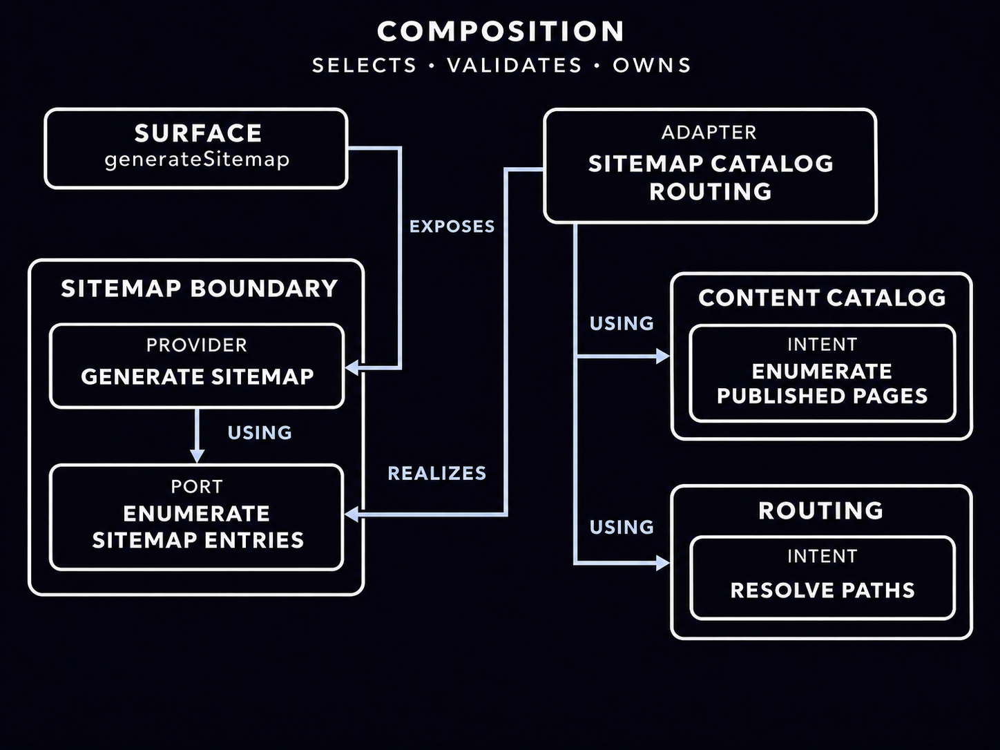

Over the past year, I have reviewed many AI-generated changes that looked perfectly reasonable in isolation. Then, after enough iterations, I would try to make a small change by hand and realize that I no longer felt confident about it.

The codebase had not necessarily turned into spaghetti. But changing, introducing, or removing a feature meant editing several parts of it, some obvious and others much less so. I often expected TypeScript to keep those points aligned, but encoding every relevant relationship in the type system was not always possible. Some connections remained implicit, and I had to remember where they were.

Sure, I could find all the impacted pieces of code by search. But I realized I no longer carried a compact model of the system in my head.

That loss of confidence started to bother me. Humans do not understand a system as a list of grep results. We need concepts that compress it: a few centers of gravity that tell us where to look.

This pushed me toward a narrower design question: could some of those concepts become explicit and executable?

Could the code tell us:

- who owns a capability?
- what that capability promises?
- how it is realized?
- where architectural spaces meet?
- which realizations form one running application?

## Locally correct pull requests can still produce global drift

AI did not invent architectural drift: teams were already capable of spreading one decision across handlers, repositories, modules, configuration, and dependency injection code.

AI changes the rate at which this can happen, even for a solo developer.

When another local implementation is cheap, there is less immediate pressure to stop and find the stable concept behind it. A pull request can introduce one more type, mapping, or direct dependency without looking wrong on its own. The cost becomes visible only after many individually reasonable decisions have accumulated.

I have started using three informal names for the failure mode I observe. They are not intended as universal terminology. They are working definitions based on my own experience.

**AI shotgun** is what happens when one conceptual change becomes many distributed edits. The agent can find and update them quickly, so the dispersion does not hurt immediately. But those locations must remain synchronized in every later change.

**AI amnesia** is the loss of the human mental map. I may have read and reviewed every generated change, yet the speed of production — and the decision to delegate part of the design — means I do not retain where responsibilities ended up or which path connects them.

**AI lock-in** follows from the first two. Once I am no longer confident that a local edit is actually local, I delegate even small changes back to the agent. Not because the code is impossible to understand, and not because I am locked into a particular model vendor, but because navigating the distributed consequences manually has become too expensive.

The loop reinforces itself. Delegation increases throughput, which creates more distributed change and weakens the mental model. Once that happens, further delegation becomes the easiest way to navigate the consequences.



_AI-assisted velocity can reinforce a loop that makes distributed knowledge increasingly difficult to own without further delegation._

I explored the broader relationship between AI and cognitive compression in [AI doesn't make Domain-Driven Design less important. It makes it essential](/blog/ai-makes-domain-driven-design-essential/).

The relevant point here is narrower: if architecture exists only as a convention reconstructed from implementation details, both humans and agents have to rediscover it for every task.

## Architecture is also information compression

A good boundary becomes a compression point.

It says that a coherent set of capabilities and contracts has an owner. It gives the rest of the system a place to refer to that ownership without knowing every implementation detail behind it. When a responsibility moves, the boundary also gives us something precise to discuss: are we moving an implementation, changing what the capability means, or discovering a similar need elsewhere in the system?

TypeScript has no first-class notion of an architectural boundary. Any module can import another, so deciding where one vocabulary stops and another begins is left to us. Orders speaks about orders and business failures; SQLite speaks about statements, rows, and database failures. They have to collaborate, but mixing those languages makes an infrastructure decision part of the Orders model. Replacing SQLite can then require changing code that should only know about orders.

I do not think this concern belongs only to domain boundaries. SQLite is not a DDD Bounded Context and does not have the same semantic role as Orders, but both are architectural spaces in the same system. One speaks the language of the business and the other the language of infrastructure. Giving both an explicit identity makes the crossing between them something we can see and discuss.

That does not keep either language clean on our behalf. Nothing stops us from defining an Orders contract in terms of a database row, a cookie, or `localStorage`. But once the owner is explicit, that vocabulary appears in a contract claiming to belong to Orders. The mismatch becomes easier to notice.

A directory does not create this kind of boundary by itself. A package can contain an internally tangled collection of responsibilities, and a coherent architectural boundary can span several packages. Filesystem structure helps people see isolation, but it is only one possible representation of it.

Forma starts here, as a deliberately limited experiment: make this concept of "Boundary" explicit in code, as the first separation between abstractions that should not share the same language.

## From a boundary to an executable promise

In Forma, a **Boundary** owns a language. An Orders Boundary can speak about order identifiers, orders, and expected failures such as `not_found`. A SQLite Boundary can speak about statements, rows, and database error codes. Similar TypeScript shapes do not make those concepts identical.

A Boundary is “closed” in a limited sense: it owns an identifiable vocabulary, and within Forma's model, a dependency that crosses into another Boundary is represented explicitly in the graph. This does not make the Boundary an import barrier or require it to live in a dedicated package.

Ownership alone is not enough. A caller also needs a stable way to say what it wants without importing the implementation that currently provides it. Forma calls that stable promise an **Intent**. Its contract fixes the input, successful value, and expected error in the Boundary's own language:

```ts
import { boundary } from "@xndrjs/forma";

type SitemapEntry = {
  readonly location: string;
  readonly lastModifiedAt: string;
};
type GeneratedSitemap = { readonly entries: readonly SitemapEntry[] };

export const Sitemap = boundary("sitemap");

export const EnumerateSitemapEntries = Sitemap.intent("enumerateSitemapEntries").contract<
  void,
  readonly SitemapEntry[],
  never
>();

export const GenerateSitemapUseCase = Sitemap.intent("generateSitemapUseCase").contract<
  void,
  GeneratedSitemap,
  never
>();
```

`GenerateSitemapUseCase` is the operation we intend to expose. `EnumerateSitemapEntries` expresses another capability Sitemap needs, in Sitemap's own language. The Intent does not determine whether that capability will be realized inside Sitemap or connected to another Boundary later. It doesn't know whether the entries come from memory, a CMS snapshot, a database, or a remote service. I will return later to why public operations and dependencies share the same representation.

Neither contract currently declares an expected error, so its error type is never. We’ll return to error handling later.

### From a contract to a realization

The Intents above still cannot execute. The public operation needs a realization, and that realization needs a way to declare its dependency on the other Intent. A **Provider** supplies both: it associates one Intent with ordinary TypeScript code and lists the other Intents that code requires. `using` makes the immediate dependency explicit before the realization runs:

```ts
export const GenerateSitemapProvider = GenerateSitemapUseCase.provide
  .using({ enumerateEntries: EnumerateSitemapEntries })
  .with(({ deps: { enumerateEntries }, out }) => {
    return async function generateSitemap() {
      const outcome = await enumerateEntries();

      switch (outcome.kind) {
        case "success":
          return out.success({ entries: outcome.value });
        default:
          return outcome;
      }
    };
  });
```

The `out` value constructs outcomes valid for this Intent's contract. The `default` branch forwards a non-successful dependency outcome without trying to reinterpret it inside Sitemap; we will look at that protocol shortly.

A Provider created directly from an Intent may use only Intents owned by the same Boundary. `GenerateSitemapProvider` can therefore depend on `EnumerateSitemapEntries`, which belongs to Sitemap, but it cannot depend directly on an Intent owned by SQLite or another Boundary. Cross-Boundary collaboration requires an explicit Adapter, which we will introduce below.

Declaring Providers still does not answer which realization a particular application should use. A test may use memory while production uses a CMS; two realizations of the same Intent cannot both be the answer inside one running graph. The application therefore needs one unit that selects a coherent set of Providers, verifies that every required Intent is satisfied, and owns the resulting runtime. Forma calls that unit a **Composition**.

A Composition distinguishes the operations it exposes — its **Surface** — from the Providers and Adapters registered only to satisfy inner dependencies. The concrete sitemap Composition later in the article will show that distinction in code.

The four concepts now have distinct jobs:

- the Boundary owns the language;
- the Intent owns the identity and contract;
- the Provider associates that Intent with one realization;
- the Composition selects one executable graph and its Surface.

Forma is therefore not a global registry where any caller can ask for any service. Many invalid declarations are rejected by TypeScript, and `compose()` also validates the runtime graph before returning a root: an incomplete graph, competing realizations, or a dependency cycle does not remain latent until the first operation needs it.

This is where Forma differs in emphasis from ordinary dependency injection. Dependency injection primarily answers how a dependency reaches a consumer. Forma first asks who owns the capability, which Intent represents it, and through which declared relationship it may cross into another architectural space. A DI container can still be a useful implementation mechanism; it simply does not necessarily preserve these distinctions by itself.

## The part TypeScript cannot put in a function signature

We now have the pieces needed to build a graph, but the Intent contract is still incomplete if callers must also guess which exceptions an operation may throw or which failures its Promise may reject with. `Promise<T>` describes the fulfilled value; it does not declare the rejection channel. A synchronous function has the same limitation.

This turns exception handling into a discovery problem. To handle a rejection deliberately, the caller has to know which exceptions can emerge from the Provider, its dependencies, a database driver, a remote SDK, a parser, or any other implementation detail involved along the way. A `catch` does not recover that missing contract. It receives `unknown`, and TypeScript cannot tell us which cases are meaningful.

The architectural risk is larger than missing type information. An Orders use case may start catching a SQLite error code because its current realization happens to use SQLite, even though the database lives several levels below Orders. The code may work, but the caller has crossed the Boundary to interpret infrastructure vocabulary. Replacing the realization can then change the exceptions that escape without changing the Intent's signature.

A Boundary can deliberately translate a technical failure into an expected error when callers are meant to act on it. That error becomes data and appears in the Intent's contract. What the Boundary cannot classify should not become another implicit branch that every caller has to rediscover.

Forma therefore **totalizes** the operation performed by a Boundary invocation. A Provider throw or Promise rejection becomes an `unexpectedFailure`, while callers receive only an opaque failure identity that they can report or propagate without interpreting the underlying cause as domain data. The four branches — `success`, `expectedError`, `unexpectedFailure`, and `cancelled` — form the `InvocationOutcome` protocol used by the Provider above. Cancellation stays distinct so an Adapter can propagate it without reclassifying it as either a domain error or an unexpected failure.

An error that crosses a Boundary as something callers may handle must be catalogued by that Boundary. Everything else remains unexpected without becoming invisible. Host abort, rollback, disposal, and other lifecycle failures have separate rules; the [technical documentation](/v0/application-architecture/forma/errors-and-outcomes/) describes those distinctions.

## When two boundaries need to collaborate

A closed vocabulary still has to collaborate with the rest of the system without silently collapsing into another language.

Forma gives that collaboration an explicit identity. An **Adapter** is scoped to one target Boundary and realizes one of its Intents while using Intents from any Boundary. It is the place where input, successful values, and expected errors can be translated.

Suppose Page Builder needs to resolve a page without adopting Routing's contract directly. It owns a local Intent named `ResolvePage`: it accepts `{ pageId }`, returns a Page Builder `PageLocation`, and reports `page_not_found`. Routing instead resolves batches: `ResolvePaths` accepts `{ pageIds }` and returns both the `ResolvedPath` values it found and the IDs it could not resolve. An unresolved ID is part of a successful batch result, not an error for the whole operation.

The concepts are related, but they are not the same. Page Builder asks about one page, so its Adapter interprets Routing's partial result: a resolved ID becomes a `PageLocation`, while an unresolved ID becomes `page_not_found`.

The Adapter first looks for the requested ID among the resolved paths. If it is not there, it checks whether Routing classified it as unresolved. If the ID appears in neither collection, Routing violated its contract at runtime, so the Adapter returns an opaque Unexpected Failure. Unexpected Failures and Cancellations already produced downstream pass through unchanged:

```ts
const PageBuilderRouting = adapter("page-builder-routing", PageBuilder);

export const ResolvePageViaRoutingProvider = PageBuilderRouting.adapt(ResolvePage)
  .using({ resolvePaths: ResolvePaths })
  .with(
    ({ deps: { resolvePaths }, out }) =>
      async function resolvePage(page) {
        const outcome = await resolvePaths({ pageIds: [page.pageId] });

        switch (outcome.kind) {
          case "success": {
            const resolved = outcome.value.resolved.find(({ pageId }) => pageId === page.pageId);

            if (resolved) {
              return out.success({
                id: resolved.pageId,
                canonicalPath: resolved.canonicalPath,
              });
            }

            if (outcome.value.unresolvedPageIds.includes(page.pageId)) {
              return out.expectedError({ code: "page_not_found" });
            }

            return out.unexpectedFailure();
          }
          default:
            return outcome;
        }
      }
  );
```

The Adapter is not a generic mapper added because two interfaces fail to line up. It records an architectural statement: Page Builder's local need is currently realized through Routing. If either side evolves, the translation remains localized instead of leaking into both Boundaries.



_The Adapter points toward Page Builder: it realizes a Page Builder-owned Intent even though it uses Routing._

## Boundaries can be discovered after the system starts moving

The most useful boundaries are not always obvious at the beginning of a project.

Consider a CMS-driven editorial system. Initially, Sitemap needs to obtain the entries it will include. That dependency is expressed by the Sitemap-owned `EnumerateSitemapEntries` Intent, whose first realization can discover published pages, calculate their canonical paths, and combine both into Sitemap entries. This is a reasonable starting point: Sitemap asks for what it needs in its own language, and there is no evidence yet that either path resolution or page enumeration needs a separate owner.

Later, Page Builder needs to resolve editorial paths to create page previews and resolve internal links.

Several locally reasonable options now exist. Page Builder could call Sitemap's public use case, but then it would depend on vocabulary and behavior intended for sitemap generation. It could resolve paths independently, but route rules, failure mapping, and CMS translation could drift. Or both could import the same helper, which shares code without answering who owns the capability.

The second consumer gives path resolution meaning independent from Sitemap. That is the moment a `Routing` Boundary becomes useful.

Routing now owns `ResolvePaths`. Sitemap still keeps `EnumerateSitemapEntries`, while Page Builder keeps `ResolvePage`; Adapters let both consumers reach Routing without adopting its contract as their own.



_Boundary discovery is a change of ownership, not a demand for early prediction. The precise Intent and Provider wiring remains in code; the architectural move is that path resolution gains an independent owner._

Then another requirement arrives. A migration or verification script needs to enumerate every published page, but it does not need sitemap entries and may not need paths at all. Reusing Sitemap would give the script vocabulary and behavior belonging to sitemap generation; independently querying the CMS would duplicate the knowledge of what counts as published content.

This second consumer reveals another capability that had previously looked like an implementation detail of Sitemap: the system has a catalog of published pages. That is the moment a small `ContentCatalog` Boundary becomes useful. It owns `EnumeratePublishedPages`, which returns page identities and modification timestamps without deciding how those pages will be presented or routed.

Sitemap still keeps its `EnumerateSitemapEntries` Intent. Its Adapter now obtains the published pages from ContentCatalog, asks Routing to resolve their canonical paths, and combines both results into Sitemap entries. The migration or verification flow can use ContentCatalog without depending on Sitemap, while Routing continues to resolve paths without knowing why they were requested.

## Moving a realization should not require a new representation

One common TypeScript implementation of Ports and Adapters gives the two roles different forms in code: a port is an interface, while a use case is a function or callable service.



_When role and representation coincide, changing the role of an operation can also require changing its shape in code._

This is a reasonable mapping, not a requirement of Ports and Adapters. But it lets the current architectural role determine the code shape. If an operation that was implemented locally later needs to be fulfilled from another Boundary, code whose meaning has not changed may still need to be recast as an interface plus an injected implementation.

Forma uses one representation for both roles:



_The entry use case stays inside Boundary A. The Adapter changes only how its dependency is realized._

Forma keeps role separate from representation. Use cases and ports are both represented as Intents: stable identities and contracts expressed in the language of their Boundary. An Intent realized by a Provider in its own Boundary behaves as a use case; one realized through an Adapter behaves as a port. In both cases, consumers depend on the same Boundary-owned contract.

That leaves room for the architecture to evolve. A realization may start inside a Boundary and later move to a more appropriate one; the original Intent remains in place, while the Composition selects an Adapter-backed Provider. The use case does not need to be redesigned around a new representation.

## Composition makes the current answer inspectable

After extracting Routing and ContentCatalog, the declarations still describe several possible pieces rather than one application. We need to choose the public use cases and keep the internal Boundaries, infrastructure, and Adapters reachable only as dependencies. Forma also requires us to name the **Entry Boundaries** that own those public roots. This prevents an infrastructure Provider or an Adapter from becoming an accidental shortcut around the Boundary it is supposed to support.

The [Editorial demo](https://github.com/xndrjs/toolkit/tree/develop/apps/forma-demo/src/editorial) chooses `generateSitemap` and `createPagePreview` as its Surface. Their Providers belong to Sitemap and Page Builder, so those are its Entry Boundaries. ContentCatalog, Routing, the CMS snapshot, and the Adapters remain in `wiring`, outside the Surface. The demo uses a committed snapshot so it can run without credentials; a production root could realize the same Intents through a CMS, a database, or a remote service.

The Composition is where that answer becomes explicit:

```ts
export function composeEditorial() {
  return compose({
    entryBoundaries: [Sitemap, PageBuilder],
    surface: {
      generateSitemap: GenerateSitemapProvider,
      createPagePreview: CreatePagePreviewProvider,
    },
    wiring: [
      EnumerateSitemapEntriesViaCatalogAndRoutingProvider,
      ResolvePageViaRoutingProvider,
      EnumeratePublishedPagesViaCmsSnapshotProvider,
      ResolvePathsViaCmsSnapshotProvider,
      ReadSnapshotProvider,
    ],
  });
}
```



_The Adapter realizes Sitemap's local port by combining two external Intents; it does not wrap their Providers. The Composition independently selects the Providers behind ContentCatalog and Routing._

The Providers registered in `wiring` are required to execute the Surface, but they do not become accidental entry points themselves.

A compiled graph would still be a poor mental map if only Forma could see it. `describePlan()` exposes a read-only description of the Composition: its Entry Boundaries and Surface, every registered Provider identified by its Intent and origin, its unary or streaming mode, and its declared and graph-derived lifetime. Reading the plan does not create any Provider instances.

That description can be given directly to an agent as task context. For a task such as “add a field to the page preview”, it shows that `createPagePreview` is a public Page Builder operation and provides an inventory of the Boundaries and Adapters selected for this Composition. It is not yet a dependency trace for that Surface root, so the agent still has to follow the relevant `using` declarations. But the search begins from named architectural elements rather than from arbitrary imports across the repository.

## The patterns that emerge

The Sitemap example shows two changes that Forma tries to keep local: replacing a realization and introducing a new Boundary only after the need appears.

### A realization can change without changing the Intent

An implementation can change from memory to SQLite, from a CMS SDK to an internal service, or from one orchestration strategy to another. If the meaning and contract remain stable, consumers still depend on the same Intent. The Composition selects another Provider for that identity, and each Provider retains the origin with which it was declared.

### A capability can acquire its own Boundary

The Routing extraction is one example. The same move is possible with ordinary code, but when identity, contract, and realization are embodied by the same function, it can also require introducing a port, changing how dependencies are passed, and updating consumers that called the function directly. With Forma, each consumer can keep an Intent in its own language while an Adapter connects that local need to the new owner.

I think of this as a **dynamic seam**. It is not runtime service lookup, nor an argument for turning every helper into an Intent. It is a Boundary crossing introduced when the system provides evidence that the crossing is useful.

### A runtime change can remain an application detail

A Boundary can describe a capability such as cookies, local storage, persistence, or remote data access without forcing its consumer to know whether the current realization runs in a browser, server process, test, or worker. Changing runtime is not automatically free — the contracts must still be honest — but the point of change becomes explicit and replaceable.

For example, a Cookies Boundary can keep the same Intent while a browser Composition selects a realization backed by browser cookies and a server Composition selects one backed by the request and response. Consumers depend on the capability rather than either runtime API.

### Public traversal remains deliberate

The Surface is not a catalogue of everything registered in the graph. It exposes selected Providers owned by declared Entry Boundaries. Infrastructure and Adapters remain reachable through dependencies without becoming public shortcuts.

## What Forma does and does not do

These patterns are possible without Forma. A disciplined team can encode them through modules, factories, naming conventions, dependency rules, and careful review. Forma's value is to give selected architectural relationships a common interface and let both TypeScript and `compose()` reject inconsistencies in the graph declared through that interface before an operation is invoked.

Once ownership and realization are explicit, the runtime can coordinate resource lifetimes, convert uncatalogued throws and rejections into opaque outcomes so callers across the Boundary receive no raw cause, and clean up streaming work coherently. The [technical documentation](/v0/application-architecture/forma/) covers those runtime policies in detail.

Forma does not replace domain modeling, Clean Architecture, thoughtful repository structure, or the judgment required to discover useful Boundaries. It cannot tell us whether Routing has genuinely acquired independent meaning.

It also does not inspect arbitrary imports or prevent code from bypassing its model. A module can still import infrastructure directly, and an Orders Intent can still expose a database row. Forma can validate only the relationships expressed through its Boundaries, Intents, Providers, Adapters, and Compositions.

Within that scope, it can preserve architectural decisions once we make them and keep the selected application model inspectable.

## From memory to an executable model

AI did not create the problem that led me here. It made it easier to reach a state in which every individual change looked reasonable while the relationships between those changes became harder to retain. I could recover the references with search, but not the compact architectural model I wanted to reason from.

Forma is an experiment in making part of that mental map inspectable. A change can start from a named Boundary and Intent, then follow selected Providers and Adapter crossings instead of inferring the whole path from unrelated imports. That does not remove design work or the need to read code; it gives that work a declared structure.

Choosing those Boundaries remains design work. Forma's narrower job begins after we draw them: keeping their contracts, crossings, and selected realizations explicit in the running application.

The library is currently alpha. Its [technical documentation](/v0/application-architecture/forma/) describes the implemented API, guarantees, lifecycle, error protocol, streaming model, and current limitations.
