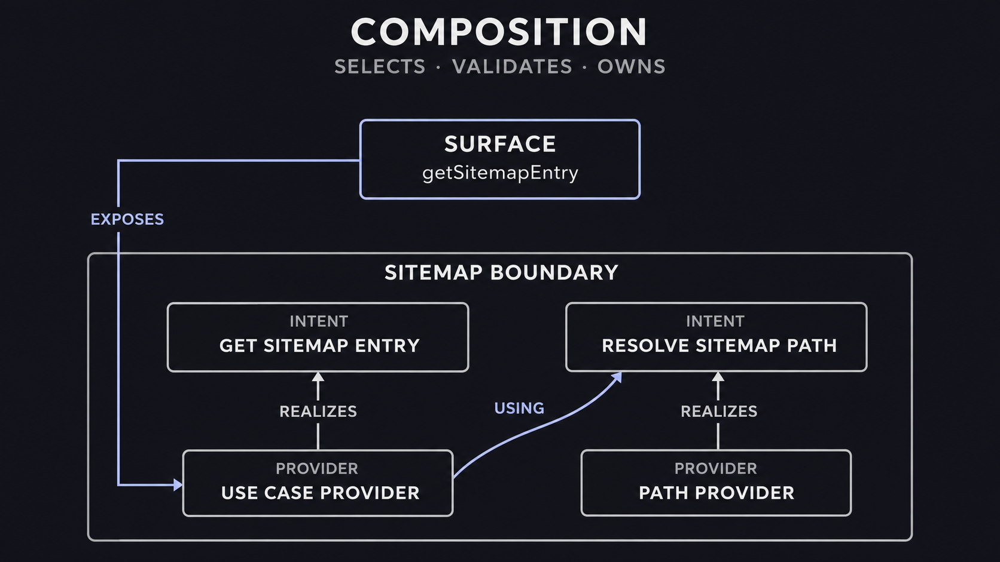
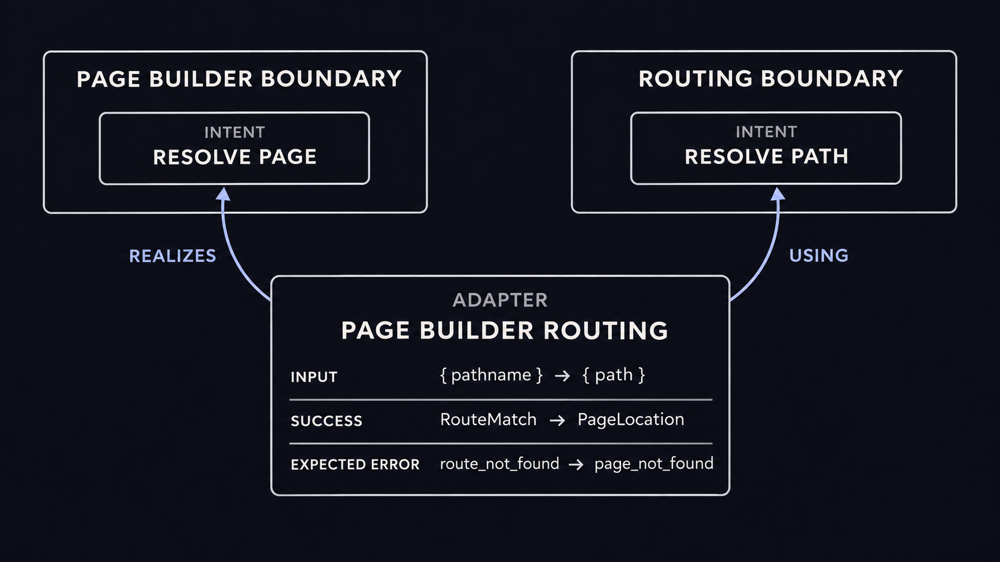
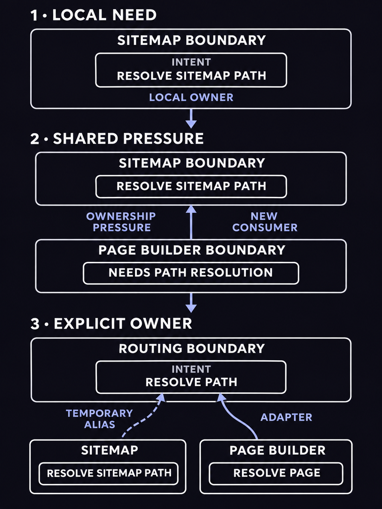

Over the past year, I have reviewed much AI-generated code that often looked perfectly reasonable, in isolation. Then, after enough iterations, I would try to make a small change by hand and realize that I wasn't feeling confident about it.

The codebase had not necessarily turned into spaghetti - but indeed, a network of references appeared, and had to remain aligned: a type here, a mapping there, a factory in another package, a convention encoded in two call sites, and so on.

I could recover the path with search. But I realized I no longer carried a compact model of the system in my head.

That feeling started to grow uncomfortable on me. Humans do not understand a system as a list of grep results. We need concepts that compress it.

This pushed me toward a narrower design question: could some of those concepts become explicit and executable?

Could the code tell us

- who owns a capability?
- what that capability promises?
- how it is realized?
- where architectural spaces meet?
- which realizations form one running application?

## Locally correct pull requests can still produce global drift

AI did not invent architectural drift: teams were already capable of spreading one decision across handlers, repositories, modules, configuration, and dependency injection code.

What AI changes is the rate at which this can happen. Even with a solo developer.

When producing another local implementation is cheap, there is less immediate pressure to stop and find the stable concept behind it. A pull request can introduce one more type, one more mapping, or one more direct dependency without looking obviously wrong. The cost becomes visible only after many individually acceptable decisions have accumulated.

I have started using three informal names for the failure mode I observe. They are not intended as universal terminology. They are working definitions based on my own experience.

**AI shotgun** is what happens when one conceptual change becomes many distributed edits. The agent can find and update them quickly, so the dispersion does not hurt immediately. But those locations must remain synchronized in every later change.

**AI amnesia** is the loss of the human mental map. I may have read and reviewed every generated change, yet the speed of production — and the decision to delegate part of the design — means I do not retain where responsibilities ended up or which path connects them.

**AI lock-in** follows from the first two. Once I am no longer confident that a local edit is actually local, I delegate even small changes back to the agent. Not because the code is impossible to understand, and not because I am locked into a particular model vendor, but because navigating the distributed consequences manually has become too expensive.

The loop reinforces itself: delegation increases throughput; throughput increases distributed change; distributed change weakens the mental model; and the weaker mental model makes further delegation feel necessary.


_AI-assisted velocity does not create architectural drift, but it can reinforce a loop that makes distributed knowledge increasingly difficult to own without further delegation._

I explored the broader relationship between AI and cognitive compression in [AI doesn't make Domain-Driven Design less important. It makes it essential](/blog/ai-makes-domain-driven-design-essential/).

The relevant point here is narrower: if architecture exists only as a convention reconstructed from implementation details, both humans and agents have to rediscover it for every task.

## Architecture is also information compression

Developers rarely keep a whole dependency graph "in working memory". We compress it into a smaller number of concepts: Orders, Payments, Routing, Page Builder, PostgreSQL, observability. Those concepts become centers of gravity. They tell us where to look, which language to expect, and which changes should remain local.

A good boundary is one of those compression points.

It says that a coherent set of capabilities and contracts has an owner. It gives the rest of the system a place to refer to that ownership without knowing every implementation detail behind it. When a responsibility moves, the boundary also gives us something precise to discuss: did its implementation move, did its meaning move, or did another part of the system merely acquire a similar need?

This is not automatically guaranteed by putting files in a directory. A package can contain an internally tangled collection of responsibilities, and a coherent architectural boundary can span several packages. Filesystem structure helps people see isolation, but it is only one possible representation of it.

The question that led to Forma was therefore not “how should these folders be arranged?” It was: what is the smallest executable model that can make architecture explicit and enforced?

## From a boundary to an executable promise

In Forma, a **Boundary** owns a language. An Orders boundary can speak about order identifiers, orders, and expected failures such as `not_found`. A SQLite boundary can speak about statements, rows, and database error codes. Similar TypeScript shapes do not make those concepts identical.

A boundary is “closed” in a specific sense. It has an identifiable vocabulary, declares the capabilities it provides or requires, and makes every relationship with another architectural space explicit. It does not mean the boundary has no dependencies, runs in a sandbox, or must live in a dedicated package.

Ownership alone is not enough. A caller also needs a stable way to say what it wants without importing the implementation that currently provides it. Forma calls that stable promise an **Intent**. Its contract fixes the input, successful value, and expected error in the Boundary's own language:

```ts
import { boundary } from "@xndrjs/forma";

type SitemapPath = { readonly path: string };
type SitemapRouteMatch = { readonly pageId: string; readonly canonicalPath: string };
type SitemapEntry = { readonly location: string; readonly pageId: string };
type SitemapError = { readonly code: "route_not_found" };

export const Sitemap = boundary("sitemap");

export const ResolveSitemapPath = Sitemap.intent("resolveSitemapPath").contract<
  SitemapPath,
  SitemapRouteMatch,
  SitemapError
>();

export const GetSitemapEntryUseCase = Sitemap.intent("getSitemapEntryUseCase").contract<
  SitemapPath,
  SitemapEntry,
  SitemapError
>();
```

`ResolveSitemapPath` is a lower-level capability used inside Sitemap. `GetSitemapEntryUseCase` is the use case we eventually want to expose. Both are Intents because both need a stable identity and a replaceable realization; neither says whether its data comes from memory, a CMS snapshot, PostgreSQL, or a remote service.

The contract would still be incomplete if a caller had to handle its typed error and also guess which exceptions the returned Promise might reject with. At an accepted Boundary invocation, Forma represents success, expected errors, unexpected failures, and cancellation as explicit outcomes. An unexpected failure is deliberately opaque outside the Boundary that produced it: callers can propagate its identity, but cannot interpret an uncatalogued cause as domain data.

The Intents above still cannot execute. The use case needs a realization, and that realization needs a way to declare its dependency on path resolution. A **Provider** supplies both: it says how one Intent is realized and lists the other Intents required to build that realization. `using` makes this dependency subgraph visible before any code runs:

```ts
export const GetSitemapEntryProvider = GetSitemapEntryUseCase.provide
  .using({ resolvePath: ResolveSitemapPath })
  .with(({ deps: { resolvePath }, out }) => {
    return async function getSitemapEntry(path) {
      const outcome = await resolvePath(path);

      switch (outcome.kind) {
        case "success":
          return out.success({
            location: outcome.value.canonicalPath,
            pageId: outcome.value.pageId,
          });
        case "expectedError":
          return out.expectedError(outcome.error);
        default:
          return outcome;
      }
    };
  });
```

The `out` value constructs outcomes valid for this Intent's contract. The two non-semantic branches—Unexpected Failure and Cancellation—are already represented by Forma, so the `default` branch propagates them without trying to reinterpret them inside Sitemap.

Declaring Providers still does not answer which realization a particular application should use. A test may use memory while production uses a CMS; two realizations of the same Intent cannot both be the answer inside one running graph. The application therefore needs one unit that selects a coherent set of Providers, verifies that every required Intent is satisfied, and owns the resulting runtime. Forma calls that unit a **Composition**.

Selection alone is not enough. Registering an infrastructure Provider should not make it part of the application's public API. A Composition therefore distinguishes selected public operations—its **Surface**—from private dependency wiring, and declares which **Entry Boundaries** are allowed to own Surface roots.

This separation is deliberately small:

- the Boundary owns the language;
- the Intent owns the promise;
- the Provider owns one realization;
- the Composition selects, validates, exposes, and owns one executable graph.

Forma is therefore not a global registry where any caller can ask for any service. Before returning an executable root, a Composition rejects incomplete graphs, competing realizations, and cycles, then assumes runtime ownership of the selected Providers.



_The Boundary owns the language and its realizations. The Composition selects and owns the executable graph, while the Surface exposes only the deliberately chosen root._

This is where Forma differs in emphasis from ordinary dependency injection. Dependency injection primarily answers how a dependency reaches a consumer. Forma first asks who owns the capability, which Intent represents it, and through which declared relationship it may cross into another architectural space. A DI container can still be a useful implementation mechanism; it simply does not necessarily preserve these distinctions by itself.

## When two boundaries need to collaborate

Boundaries are useful only if they can collaborate without silently collapsing into one language.

Forma gives that collaboration an explicit identity: an **Adapter** realizes an Intent owned by a target Boundary by using Intents from other Boundaries. It is the place where input, successful values, and expected errors can be translated.

Suppose Page Builder needs to resolve a page without adopting Routing's contract directly. It owns a local Intent named `ResolvePage`: it works with `{ pathname }`, returns a Page Builder `PageLocation`, and reports `page_not_found`. Routing instead accepts `{ path }`, returns a `RouteMatch`, and reports `route_not_found`.

The concepts are related, but they are not synonyms. The error translation also needs to be explicit: Page Builder may interpret `page_not_found`, while Routing currently catalogues only `route_not_found`. Static types make the known mapping exhaustive, but a runtime integration can still violate its declared contract. The Adapter maps the known code and converts any uncatalogued code into an opaque Unexpected Failure rather than leaking it as a Page Builder error. Unexpected Failures and Cancellations already produced downstream pass through unchanged:

```ts
const PageBuilderRouting = adapter("page-builder-routing", PageBuilder);

export const ResolvePageViaRoutingProvider = PageBuilderRouting.adapt(ResolvePage)
  .using({ resolvePath: ResolvePath })
  .with(
    ({ deps: { resolvePath }, out }) =>
      async function resolvePage(path) {
        const outcome = await resolvePath({ path: path.pathname });

        switch (outcome.kind) {
          case "success":
            return out.success({
              id: outcome.value.pageId,
              canonicalPath: outcome.value.canonicalPath,
            });
          case "expectedError":
            switch (outcome.error.code) {
              case "route_not_found":
                return out.expectedError({ code: "page_not_found" });
              default:
                return out.unexpectedFailure();
            }
          default:
            return outcome;
        }
      }
  );
```

The Adapter is not a generic mapper added because two interfaces fail to line up. It records an architectural statement: Page Builder's local need is currently realized through Routing. If either side evolves, the translation remains localized instead of leaking into both Boundaries.



_An Adapter is an architectural bridge, not just a shape converter: it records which local Intent it realizes, which external Intent it uses, and how meaning crosses the Boundary._

There is one narrower migration problem for which an Adapter can express more than we mean. During a rename or staged move, an old Intent and a new Intent may temporarily be exact, contract-equivalent synonyms, with no translation or policy between them. Forma calls that relationship an **Intent alias**. It is not the normal way to connect Boundaries; when in doubt, an Adapter keeps direction, ownership, and room for future policy visible.

## Boundaries can be discovered after the system starts moving

The most useful boundaries are not always obvious at the beginning of a project.

Consider a CMS-driven editorial system. Initially, Sitemap needs to resolve a URL path to a page. The route-resolution code lives inside Sitemap, behind a private `ResolveSitemapPath` Intent. That is a good design: there is one consumer, one owner, and no evidence that the capability deserves an independent architectural identity.

Later, Page Builder needs to resolve the same editorial paths to create page previews.

Several locally reasonable options now exist. Page Builder could call Sitemap's public use case, but then it would depend on vocabulary and behavior intended for sitemap generation. It could copy the resolver, but route rules, failure mapping, and CMS translation could drift. Or both could import the same helper, which shares code without answering who owns the capability.

The new pressure reveals something that was not true, or at least not useful, before: route resolution has acquired meaning independent from Sitemap.

That is the moment a `Routing` Boundary becomes valuable.

The realization moves behind `Routing.ResolvePath`. Page Builder keeps its own `ResolvePage` Intent and reaches Routing through an Adapter. Sitemap can migrate in the same way. In the current Forma demo, it temporarily uses an Intent alias because the old and new contracts are exact synonyms; that alias is explicit migration debt and can later be replaced with a Sitemap-to-Routing Adapter.



_A new Boundary does not need to be predicted in advance. It can emerge when a capability acquires meaning beyond its original owner, while existing consumers retain local seams and migrate explicitly._

This is not a story about correcting an obviously bad initial architecture. Extracting Routing on day one would have required predicting a reuse case that did not yet exist. Leaving the capability in Sitemap forever would ignore evidence that arrived later.

The architectural property I want is not perfect foresight. It is the ability to move ownership without making the meaning of every consumer move with it.

## Composition makes the current answer inspectable

After extracting Routing, the declarations still describe several possible pieces rather than one application. We need to choose the public use cases, authorize the Boundaries from which public traversal may begin, and keep Routing, infrastructure, and Adapters reachable only as dependencies.

The Editorial demo chooses `getSitemapEntry` and `createPagePreview` as its Surface. Their Providers belong to Sitemap and Page Builder, so those are its Entry Boundaries. Routing, the CMS snapshot, and the Adapters remain private `wiring`. The demo uses a committed snapshot so it can run without credentials; a production root could realize the same Routing Intent through Contentful, another CMS, a database, or a remote service.

The Composition is where that answer becomes explicit:

```ts
export function composeEditorial() {
  return compose({
    entryBoundaries: [Sitemap, PageBuilder],
    surface: {
      getSitemapEntry: GetSitemapEntryProvider,
      createPagePreview: CreatePagePreviewProvider,
    },
    wiring: [
      aliasIntent(ResolveSitemapPath, ResolvePath),
      ResolvePageViaRoutingProvider,
      ResolvePathViaCmsSnapshotProvider,
      FindSnapshotEntryProvider,
    ],
  });
}
```

The private Providers are required to execute the Surface, but they do not become accidental entry points themselves.

A compiled graph would still be a poor mental map if only Forma could see it. The root therefore exposes `describePlan()`, a read-only description of its Surface roots, Provider origins, dependency edges, and runtime ownership. The architecture is not only encoded in types or inferred from imports; tools, tests, humans, and agents can inspect the graph that Forma actually compiled.

That matters in an agentic workflow. Instead of asking an agent to reconstruct every architectural relationship from arbitrary imports, I can give it named Boundaries, declared Intent edges, and a composition plan. Search is still useful, but it starts from centers of gravity rather than from an undifferentiated repository.

## The patterns that emerge

Once ownership and wiring have executable identities, several design moves become less dramatic.

### A Provider can move without moving the Intent

An implementation can move from memory to SQLite, from a CMS SDK to an internal service, or from one orchestration strategy to another. If the meaning and contract remain stable, consumers still depend on the same Intent. Composition selects the new realization.

### A capability can acquire its own Boundary

Routing did not need to exist before the second consumer exposed independent meaning. Once that happened, Forma provided a place to move the realization and explicit connections through which existing consumers could migrate.

### A private function can become an architectural connection

Not every helper needs an Intent and not every possible integration needs an Adapter on day one. A private function can remain a function. When stable identity, alternative realization, or cross-Boundary translation starts to matter, the connection can become explicit without changing the public meaning of the use case around it.

I think of these as **dynamic seams**: not runtime service lookup, but architectural seams introduced at the moment they become useful.

### A runtime change can remain an application detail

A Boundary can describe a capability such as cookies, local storage, persistence, or remote data access without forcing its consumer to know whether the current realization runs in a browser, server process, test, or worker. Changing runtime is not automatically free—the contracts must still be honest—but the point of change becomes explicit and replaceable.

### Public traversal remains deliberate

The Surface is not a catalogue of everything registered in the graph. It exposes selected Providers owned by declared Entry Boundaries. Infrastructure and Adapters remain reachable through dependencies without becoming public shortcuts.

These patterns are possible without Forma. A disciplined team can encode them through modules, factories, naming conventions, dependency rules, and careful review. Forma's value is to give the most important relationships a small common interface and make the resulting graph reject invalid states before execution.

## A small vocabulary with disproportionate leverage

Forma deliberately has few primary concepts: Boundary, Intent, Provider, Adapter, and Composition. That is a small public vocabulary for the amount of behavior it coordinates.

Once the runtime knows which Provider depends on which Intent, where every operation originates, and who owns each materialized realization, it can apply other policies coherently: how long resources live, how uncatalogued failures leave a Boundary, and how streaming work is cleaned up. Those capabilities matter, but they are not the conceptual starting point. They are consequences of making ownership and realization explicit enough for a runtime to reason about them.

This is the kind of depth I want from an architectural library: a relatively small interface that absorbs decisions which would otherwise be repeated across application code.

Forma does not replace domain modeling, Clean Architecture, or thoughtful repository structure. It does not decide which Boundaries an application should have. It cannot tell us whether Routing has genuinely acquired independent meaning.

What it can do is preserve that decision once we make it.

## From memory to an executable model

The answer to AI shotgun is not to prohibit distributed changes. Some changes are inherently distributed. The answer to AI amnesia is not to expect people to memorize every generated patch. And the answer to AI lock-in is not to stop using agents.

The more useful response is to give both humans and agents a stronger map.

That map needs named centers of gravity. It needs stable promises separated from current realizations. It needs visible bridges where one architectural language becomes another. And it needs one place where the application states which of those realizations form the system that runs today.

Forma is my attempt to make that part of architecture executable.

The library is currently alpha. Its [technical documentation](/v0/application-architecture/forma/) describes the implemented API, guarantees, lifecycle, error protocol, streaming model, and current limitations. The model is still evolving, but its direction is already clear: architecture should not survive only in the memory of the person—or agent—that last changed the code.
