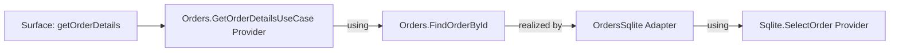
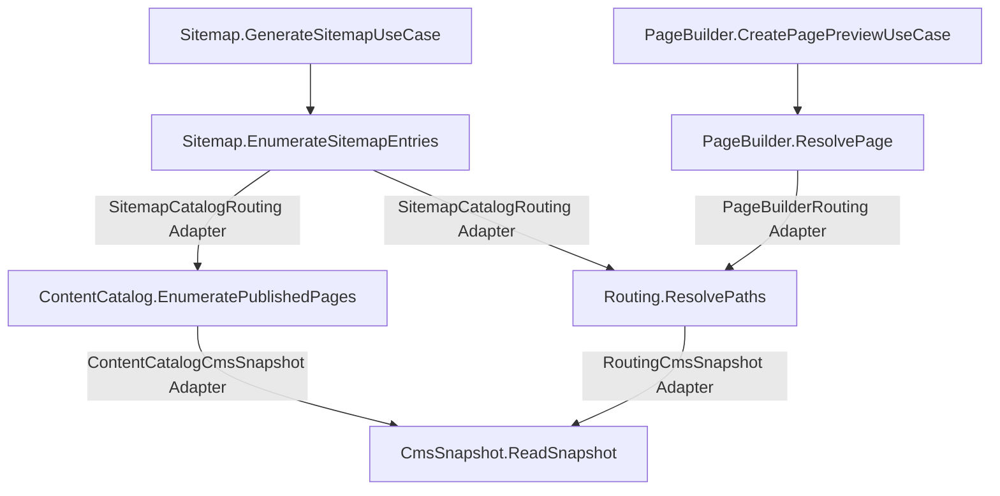

Boundary isolation does not mean Boundaries never collaborate. It means the collaboration has an
explicit owner and does not force either Boundary to adopt the other's language.

Forma gives that cross-Boundary realization an architectural identity: the Adapter.

## Realize a local seam through another Boundary

`Orders` owns the seam it needs:

```ts
type OrderId = string;
type Order = { readonly id: string; readonly total: number };
type LookupError = { readonly code: "not_found" };

const FindOrderById = Orders.intent("findOrderById").contract<OrderId, Order, LookupError>();
```

`Sqlite` owns a contract in its own vocabulary:

```ts
type SqliteOrderLookup = { readonly order_id: string };
type SqliteOrder = {
  readonly order_id: string;
  readonly amount_cents: number;
};
type SqliteFindError = { readonly code: "NO_ROW" };

const SelectOrder = Sqlite.intent("selectOrder").contract<
  SqliteOrderLookup,
  SqliteOrder,
  SqliteFindError
>();
```

An Adapter scoped to `Orders` realizes `FindOrderById` using `SelectOrder`:

```ts
import { adapter } from "@xndrjs/forma";

const OrdersSqlite = adapter("orders-sqlite", Orders);

const FindOrderByIdViaSqliteProvider = OrdersSqlite.adapt(FindOrderById)
  .using({ select: SelectOrder })
  .with(({ deps: { select }, out }) => {
    return async function findOrderById(id) {
      const outcome = await select({ order_id: id });

      return out.match(outcome, {
        success: (row) =>
          out.success({
            id: row.order_id,
            total: row.amount_cents / 100,
          }),
        expectedError: {
          NO_ROW: () => out.expectedError({ code: "not_found" }),
        },
      });
    };
  });
```

The Adapter localizes three semantic translations:

```text
Orders input            → Sqlite input
Sqlite successful value → Orders successful value
Sqlite Expected Error   → Orders Expected Error
```

`out.match` requires one handler for every `SqliteFindError.code` and narrows the payload inside
each handler. It does not reinterpret `unexpectedFailure` or `cancelled`: those branches pass
through automatically, preserving failure and cancellation identity.

If SQLite returned an Expected Error code absent from its declared Contract at runtime, the match
would fail and Forma would totalize that mismatch as a new Unexpected Failure at this Adapter. It
would not silently map the unknown condition to `not_found`.

If Adapter mapping code itself throws or rejects, that is a new failure at the Adapter origin and
Forma creates a new Unexpected Failure for it.

## Adapter is not an entry point

An Adapter is peer to Boundary and scoped to exactly one target Boundary. Its `.adapt(intent)` may
only target Intents owned by that Boundary, while its `using` map may contain Intents from any
Boundary.

The resulting Provider belongs in private `wiring`:

```ts
const root = compose({
  entryBoundaries: [Orders],
  surface: { getOrderDetails: GetOrderDetailsProvider },
  wiring: [FindOrderByIdViaSqliteProvider, SelectOrderProvider],
});
```

Putting `FindOrderByIdViaSqliteProvider` directly on the Surface would be rejected. Public traversal
starts from an Orders-owned use case, reaches the Orders-owned seam, and only then crosses the
Adapter.



This prevents an integration node with unconstrained cross-Boundary dependencies from becoming an
architectural shortcut.

## Same shape still defaults to Adapter passthrough

Two Intents can have structurally equivalent Contracts while remaining semantically distinct. They
may differ in authorization, side effects, observability, or future policy.

The default cross-Boundary connection is therefore an Adapter passthrough, even when no mapping is
required:

```ts
const RequiredViaExternal = SomeAdapter.adapt(RequiredIntent)
  .using({ external: ExternalIntent })
  .with(({ deps: { external } }) => {
    return function required(input) {
      return external(input);
    };
  });
```

The explicit Provider preserves origin, a visible graph edge, lifetime derivation, and a place for
future policy.

## Intent aliases are deliberate synonyms

Aliasing is not Forma's primary cross-Boundary connection mechanism. In most cases, use an Adapter—even
when two Contracts currently have the same shape. Structural equivalence does not prove that two
Intents have the same meaning, policy, authorization, observability, or reason to evolve.

`aliasIntent(required, satisfier)` rewrites one required Intent identity to another satisfier with
an exactly equivalent Contract, including modality.

```ts
import { aliasIntent } from "@xndrjs/forma";

aliasIntent(LegacyResolvePaths, ResolvePaths);
```

Use an alias only when the two identities are deliberate synonyms and introducing a Provider would
misrepresent that relationship. Typical cases are rare and usually temporary:

- preserving an old Intent name while consumers migrate to its replacement;
- moving an unchanged capability to a new Boundary without forcing a big-bang migration;
- maintaining a short compatibility window between two versioned identities that are formally
  defined as equivalent.

An alias is migration or compatibility wiring, not a convenient way to reuse an implementation.
It is not a realization, cannot appear on the Surface, and creates no location for translation,
policy, authorization, diagnostics, or future divergence. Sharing the same Contract, wanting to
avoid a wrapper, or depending on another Boundary are not sufficient reasons to alias.

**When in doubt, create an Adapter.** An Adapter makes the relationship explicit today and leaves a
natural place for the two sides to diverge tomorrow.

Unary and stream Intents cannot alias one another. Input, success/item, Expected Error, and modality
must be reciprocally assignable at the type level; Forma also rejects runtime modality mismatches.

## Discover a Boundary progressively

The Editorial demo captures a common evolution.

### 1. Start with a consumer-owned port

Sitemap initially owns the public use case and the private port it needs:

```text
Sitemap.GenerateSitemapUseCase
└─ Sitemap.EnumerateSitemapEntries
```

This is a good initial design. Sitemap asks for entries in its own language, and there is no
evidence yet that path resolution needs an independent architectural identity.

### 2. Let new pressure reveal the responsibility

PageBuilder later needs to resolve editorial pages too. Copying route rules and CMS translation
would allow them to drift. Depending directly on a Sitemap use case would make PageBuilder speak
the wrong architectural language.

At this point path resolution has acquired independent meaning. A new `Routing` Boundary owns
`ResolvePaths`. It does not enumerate content: a separate `ContentCatalog` Boundary owns
`EnumeratePublishedPages`.

### 3. Keep both consumers in their own language



The connections preserve four distinct vocabularies:

- `Sitemap.EnumerateSitemapEntries` expresses what sitemap generation needs;
- `ContentCatalog.EnumeratePublishedPages` owns publication-aware content enumeration;
- `PageBuilder.ResolvePage` expresses what preview generation needs, including its own Expected
  Error;
- Routing resolves canonical paths without knowing why they are requested;
- the infrastructure-oriented `CmsSnapshot` Boundary owns the local artifact format.

Only Sitemap and PageBuilder are Entry Boundaries. ContentCatalog, Routing, CmsSnapshot, and all
Adapters remain private implementation of this Composition.

### 4. Move realizations without moving consumer meaning

ContentCatalog and Routing currently derive their capabilities from a committed CMS snapshot. A
production Composition could use a remote CMS, a database, or another service without changing
either consumer-owned port.

The local Intents remain useful because they express what each consumer requires in its own
language. They do not disappear merely because Routing owns the shared realization.

## Patterns that emerge

**Progressive Boundary discovery**

A responsibility starts where it is used. A new Boundary is introduced when the responsibility
gains independent meaning, not because an initial architecture diagram predicted it.

**Dynamic seam**

An Intent may begin with a direct realization. The Provider can later orchestrate more operations,
delegate through an Adapter, or apply policy without changing consumers while the Contract remains
compatible.

**Ownership migration**

Moving responsibility does not require moving every consumer in one change. Consumer-owned seams,
Adapters, and temporary aliases allow each intermediate graph to remain closed and executable.

**Technology Boundary**

SQLite, a CMS snapshot, a remote vendor, cookies, or local storage may each own infrastructure
Intents when stable identity and replaceable wiring matter. Business Boundaries depend on their own
local seams; Composition and Adapters connect the two languages.

Continue with [Composition and execution](/v0/application-architecture/forma/composition-and-execution/)
to see how Entry Boundaries, private wiring, contexts, and shutdown enforce this direction.
