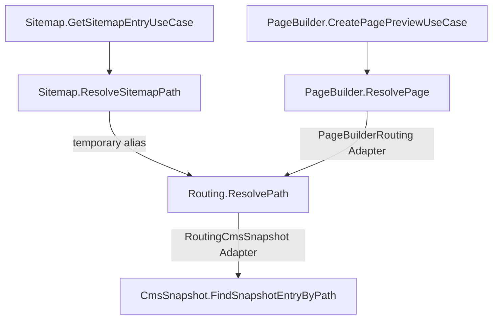

Boundary isolation does not mean Boundaries never collaborate. It means the collaboration has an
explicit owner and does not force either Boundary to adopt the other's language.

Forma gives that cross-Boundary realization an architectural identity: the Adapter.

## Realize a local seam through another Boundary

`Orders` owns the seam it needs:

```ts
type OrderId = string;
type Order = { readonly id: string; readonly total: number };
type LookupError = { readonly code: "not_found" };

const FindOrderById = Orders.intent("findOrderById").contract<OrderId, Order, LookupError>();
```

`Sqlite` owns a contract in its own vocabulary:

```ts
type SqliteOrderLookup = { readonly order_id: string };
type SqliteOrder = {
  readonly order_id: string;
  readonly amount_cents: number;
};
type SqliteFindError = { readonly code: "NO_ROW" };

const SelectOrder = Sqlite.intent("selectOrder").contract<
  SqliteOrderLookup,
  SqliteOrder,
  SqliteFindError
>();
```

An Adapter scoped to `Orders` realizes `FindOrderById` using `SelectOrder`:

```ts
import { adapter } from "@xndrjs/forma";

const OrdersSqlite = adapter("orders-sqlite", Orders);

const FindOrderByIdViaSqliteProvider = OrdersSqlite.adapt(FindOrderById)
  .using({ select: SelectOrder })
  .with(({ deps: { select }, out }) => {
    return async function findOrderById(id) {
      const outcome = await select({ order_id: id });

      switch (outcome.kind) {
        case "success":
          return out.success({
            id: outcome.value.order_id,
            total: outcome.value.amount_cents / 100,
          });

        case "expectedError":
          return out.expectedError({ code: "not_found" });

        case "unexpectedFailure":
        case "cancelled":
          return outcome;
      }
    };
  });
```

The Adapter localizes three semantic translations:

```text
Orders input            → Sqlite input
Sqlite successful value → Orders successful value
Sqlite Expected Error   → Orders Expected Error
```

It does not reinterpret `unexpectedFailure` or `cancelled`. Those branches pass through unchanged,
preserving failure and cancellation identity.

If Adapter mapping code itself throws or rejects, that is a new failure at the Adapter origin and
Forma creates a new Unexpected Failure for it.

## Adapter is an origin, not an entry point

An Adapter is peer to Boundary and scoped to exactly one target Boundary. Its `.adapt(intent)` may
only target Intents owned by that Boundary, while its `using` map may contain Intents from any
Boundary.

The resulting Provider belongs in private `wiring`:

```ts
const root = compose({
  entryBoundaries: [Orders],
  surface: { getOrderDetails: GetOrderDetailsProvider },
  wiring: [FindOrderByIdViaSqliteProvider, SelectOrderProvider],
});
```

Putting `FindOrderByIdViaSqliteProvider` directly on the Surface would be rejected. Public traversal
starts from an Orders-owned use case, reaches the Orders-owned seam, and only then crosses the
Adapter.


This prevents an integration node with unconstrained cross-Boundary dependencies from becoming an
architectural shortcut.

## Same shape still defaults to Adapter passthrough

Two Intents can have structurally equivalent Contracts while remaining semantically distinct. They
may differ in authorization, side effects, observability, or future policy.

The default cross-Boundary connection is therefore an Adapter passthrough, even when no mapping is
required:

```ts
const RequiredViaExternal = SomeAdapter.adapt(RequiredIntent)
  .using({ external: ExternalIntent })
  .with(({ deps: { external } }) => {
    return function required(input) {
      return external(input);
    };
  });
```

The explicit Provider preserves origin, a visible graph edge, lifetime derivation, and a place for
future policy.

## Intent aliases are deliberate synonyms

`aliasIntent(required, satisfier)` rewrites one required Intent identity to another satisfier with
an exactly equivalent Contract, including modality.

```ts
import { aliasIntent } from "@xndrjs/forma";

aliasIntent(ResolveSitemapPath, ResolvePath);
```

Use an alias when the two identities are intentionally the same concept during a rename or
migration. It is not a realization, cannot appear on the Surface, and does not create a location
for mapping or policy.

Unary and stream Intents cannot alias one another. Input, success/item, Expected Error, and modality
must be reciprocally assignable at the type level; Forma also rejects runtime modality mismatches.

## Discover a Boundary progressively

The Editorial demo captures a common evolution.

### 1. Start with local ownership

Sitemap initially owns both its public use case and its private path-resolution seam:

```text
Sitemap.GetSitemapEntryUseCase
└─ Sitemap.ResolveSitemapPath
```

This is a good initial design. There is one consumer and no evidence that routing needs an
independent architectural identity.

### 2. Let new pressure reveal the responsibility

PageBuilder later needs to resolve editorial paths too. Copying the logic would allow routing rules
and failure semantics to drift. Depending directly on a Sitemap use case would make PageBuilder
speak the wrong architectural language.

At this point route resolution has acquired independent meaning, so the realization moves behind a
new `Routing.ResolvePath` Intent.

### 3. Keep both consumers stable during migration



The two connections mean different things:

- `Sitemap.ResolveSitemapPath` and `Routing.ResolvePath` currently have exactly equivalent
  Contracts, so a temporary Intent alias keeps the existing Sitemap Provider unchanged;
- `PageBuilder.ResolvePage` owns different input, result, and error vocabulary, so an Adapter maps
  it to `Routing.ResolvePath`;
- Routing is realized through another Adapter using the infrastructure-oriented `CmsSnapshot`
  Boundary.

Only Sitemap and PageBuilder are Entry Boundaries. Routing, CmsSnapshot, both Adapters, and the alias
remain private implementation of this Composition.

### 4. Remove migration debt deliberately

Once the ownership move is established, the Sitemap alias can be replaced with a Sitemap-to-Routing
Adapter. It may begin as a passthrough, but it makes the cross-Boundary edge and its direction
explicit.

The local Sitemap Intent remains useful because it expresses what Sitemap requires in Sitemap's
language. It does not disappear merely because Routing now owns the shared realization.

## Patterns that emerge

**Progressive Boundary discovery**

A responsibility starts where it is used. A new Boundary is introduced when the responsibility
gains independent meaning, not because an initial architecture diagram predicted it.

**Dynamic seam**

An Intent may begin with a direct realization. The Provider can later orchestrate more operations,
delegate through an Adapter, or apply policy without changing consumers while the Contract remains
compatible.

**Ownership migration**

Moving responsibility does not require moving every consumer in one change. Consumer-owned seams,
Adapters, and temporary aliases allow each intermediate graph to remain closed and executable.

**Technology Boundary**

SQLite, a CMS snapshot, a remote vendor, cookies, or local storage may each own infrastructure
Intents when stable identity and replaceable wiring matter. Business Boundaries depend on their own
local seams; Composition and Adapters connect the two languages.

Continue with [Composition and execution](/v0/application-architecture/forma/composition-and-execution/)
to see how Entry Boundaries, private wiring, contexts, and shutdown enforce this direction.
