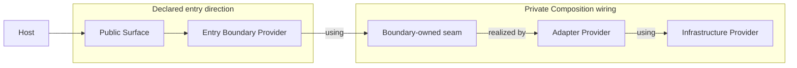

A Composition is both an architectural boundary and a runtime owner. It validates one closed graph,
publishes a selected Surface, materializes Providers lazily, and shuts down everything it owns.

## The composition shape

```ts
const root = compose({
  entryBoundaries: [Orders],
  surface: {
    getOrderDetails: GetOrderDetailsProvider,
    watchOrderEvents: WatchOrderEventsProvider,
  },
  wiring: [
    FindOrderViaSqliteProvider,
    WatchOrderEventsViaSqliteProvider,
    SelectOrderProvider,
    SelectOrderEventsProvider,
    DatabaseProvider,
  ],
  onUnexpectedFailure(event) {
    console.error(event.failure.id, event.intent, event.phase, event.cause);
  },
});
```

The four fields have distinct roles:

| Field                 | Responsibility                                                         |
| --------------------- | ---------------------------------------------------------------------- |
| `entryBoundaries`     | Exact non-empty set of Boundary origins exposed by Surface roots       |
| `surface`             | Public aliases and their Boundary-owned root Providers                 |
| `wiring`              | Private Providers and Intent aliases used to close the graph           |
| `onUnexpectedFailure` | Optional host diagnostic hook for automatic throw/rejection conversion |

Prefer an inline options literal. It preserves the exact Entry Boundary tuple, Surface Providers,
and wiring tuple needed by Forma's type-level checks.

## Entry Boundaries define direction

Every Surface root must be a Provider whose origin is one of the declared Entry Boundaries. Every
declared Entry Boundary must own at least one Surface alias.

Adapter-originated Providers cannot be Surface roots.



The Composition may traverse any number of private Boundaries. Entry Boundary does not mean one
Composition per Boundary; it only identifies where public traversal may begin.

Surface aliases are string-keyed and appear under `execution.surface`. Internal Providers never
become callable merely because they are registered in `wiring`.

## Validation happens before execution

`compose()` compiles the graph synchronously. Before returning a root, Forma validates:

- authentic Boundary, Intent, Provider, Adapter target, and Intent-alias protocol values;
- exact Entry Boundary and Surface correspondence;
- reserved and unsafe keys;
- duplicate or competing realizations;
- missing Providers after Intent-alias rewriting;
- Contract compatibility on resolved dependency edges;
- unary/stream modality compatibility;
- cycles, with the full dependency path;
- Params compatibility;
- effective lifetimes and invalid `.perComposition()` captures.

The graph is closed and executable when the root is returned. Provider factories remain lazy.

## Keep extracted configuration precise

A plain extracted array often widens to `Provider[]` and loses the tuple information needed for
missing-provider analysis. Keep wiring inline when possible.

When extraction is necessary, use `defineWiring`:

```ts
import { compose, defineWiring } from "@xndrjs/forma";

const storageWiring = defineWiring(
  FindOrderViaSqliteProvider,
  SelectOrderProvider,
  DatabaseProvider
);

const root = compose({
  entryBoundaries: [Orders],
  surface: { getOrderDetails: GetOrderDetailsProvider },
  wiring: storageWiring,
});
```

`defineComposition` serves the same purpose when the whole options bag must live elsewhere. Do not
annotate a concrete bag as bare `ComposeOptions`; its default generics intentionally describe a
widened shape and cannot retain the exact graph.

## Inspect the compiled plan

`describePlan()` returns frozen diagnostic data without materializing Providers:

```ts
console.dir(root.describePlan(), { depth: null });
```

Conceptually:

```ts
{
  entryBoundaries: ["orders"],
  surface: [
    {
      alias: "getOrderDetails",
      intent: ["orders", "getOrderDetailsUseCase"],
      origin: { kind: "boundary", id: "orders" }
    }
  ],
  providers: [
    {
      intent: ["orders", "getOrderDetailsUseCase"],
      mode: "unary",
      origin: { kind: "boundary", id: "orders" },
      lifetime: {
        declared: "context",
        effective: "context"
      }
    }
  ]
}
```

For an `auto` Provider narrowed by a context dependency, `lifetime.narrowedBy` contains the
structured Intent path that caused the decision.

The plan is useful for startup diagnostics, architecture tests, and developer tooling. It is an
explanation of the registered graph, not a mutable runtime registry.

## Choose the right execution API

| API                                   | Use when                               | Ownership                                            |
| ------------------------------------- | -------------------------------------- | ---------------------------------------------------- |
| `withExecutionContext(run, options?)` | Work fits in one lexical callback      | Forma disposes the context after the callback        |
| `openExecutionContext(options?)`      | A host lifecycle spans several calls   | Caller owns `dispose()` or `await using`             |
| `root.dispose()`                      | The whole Composition is shutting down | Root closes open contexts, then root-owned Providers |

### Lexical ownership

```ts
const outcome = await root.withExecutionContext((surface) => surface.getOrderDetails("42"), {
  params: { role: "viewer" },
});
```

If the callback and cleanup both fail, Forma throws `SuppressedError(cleanupError, callbackError)`
so the callback failure remains available rather than being overwritten by cleanup.

### Host ownership

```ts
await using execution = root.openExecutionContext({
  params: { role: "viewer" },
  signal: request.signal,
});

const outcome = await execution.surface.getOrderDetails("42");
console.log(execution.params.role);
```

Use this form when a request, component mount, job, test, or other host object determines the
lifetime. The handle exposes the normalized Params and the context signal in addition to its
Surface.

## Abort is not dispose

Every root and Execution context owns an `AbortSignal`. Entering `disposing` aborts that owner's
signal. A host signal can also be linked when opening a context.

The current channels remain distinct:

- an already-aborted host signal prevents the context from opening;
- a later host abort prevents new unary work and causes it to reject with `signal.reason`;
- a cold stream does not start after its parent signal is aborted;
- accepted Provider work and stream invocations observe cancellation cooperatively;
- host abort does not automatically dispose the context;
- only `dispose()` releases context-owned resources.

`InvocationOutcome.cancelled` represents cancellation carried as Intent data. It is not yet a
universal encoding of every host-abort path.

## Disposal is terminal

Root and context scopes use terminal state machines:

```text
open → disposing → disposed
```

When context disposal begins, Forma:

1. refuses new work;
2. aborts the context signal;
3. drains accepted unary work;
4. closes active stream invocations;
5. runs context-owned Provider cleanups.

Root disposal refuses new contexts, disposes every still-open context, and then runs
composition-owned cleanups. Concurrent calls to the same `dispose()` share one Promise, including
its rejection.

Forma attempts all cleanup paths. Multiple failures are aggregated rather than allowing the first
failure to skip later owners.

Continue with [Errors and outcomes](/v0/application-architecture/forma/errors-and-outcomes/) for
the distinction between Contract data, automatic failure totalization, host abort, and lifecycle
rejection.
