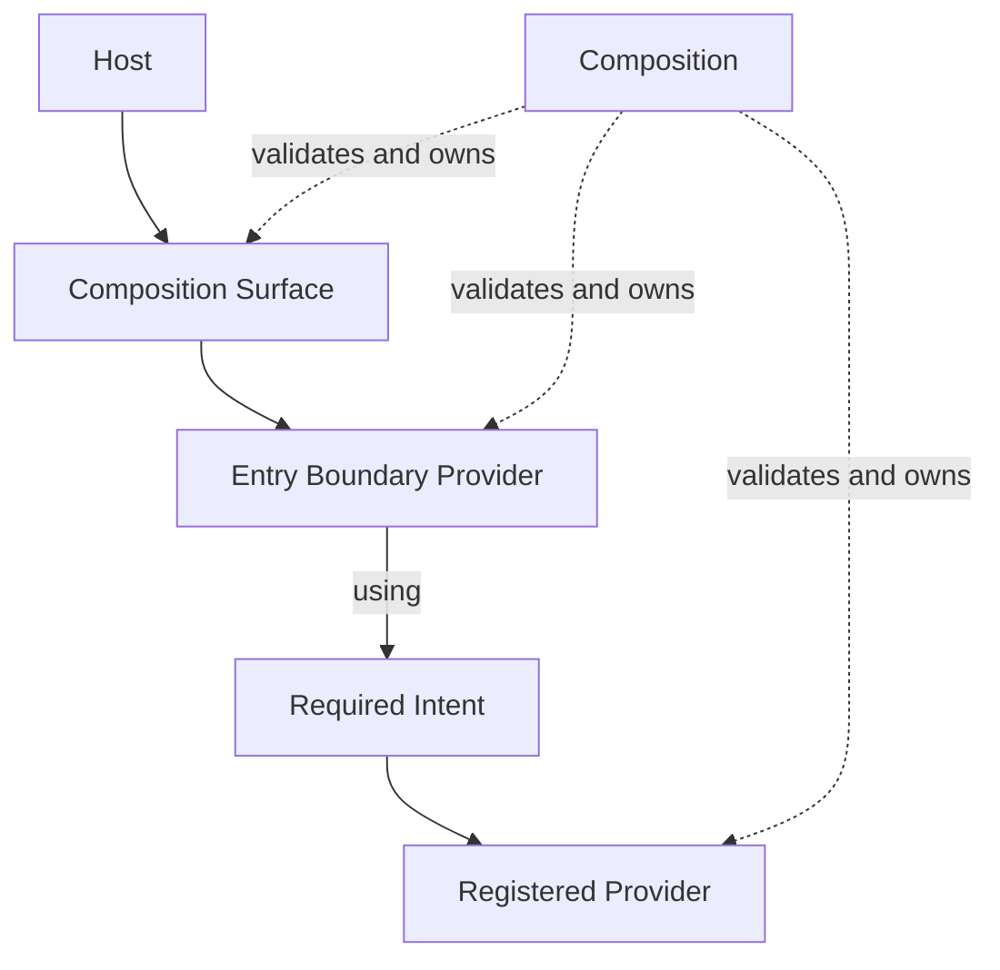
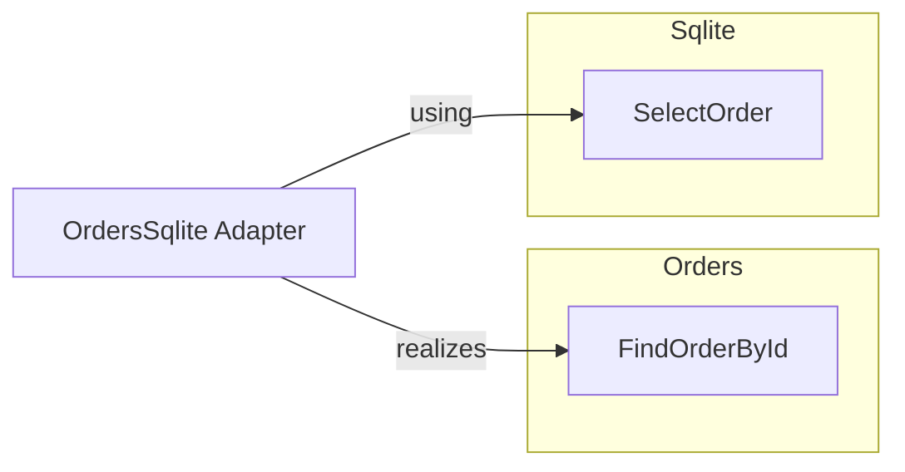

Forma models an application as a closed graph of architectural intentions and their realizations.
Its concepts are deliberately fewer than the concepts used by DDD, hexagonal architecture, or
Clean Architecture. Those vocabularies may be layered on top, but they are not aliases for Forma's
primitives.



## Boundary: who owns the language

A **Boundary** is an isolated architectural space that owns Intent identities and Contracts.

```ts
import { boundary } from "@xndrjs/forma";

export const Orders = boundary("orders");
export const Sqlite = boundary("sqlite");
```

`Orders` may speak in terms of `OrderId`, `Order`, and `not_found`, while `Sqlite` speaks in terms
of `{ order_id }`, rows, and `NO_ROW`. Even when two shapes happen to be compatible, they do not
therefore have the same meaning.

A Boundary is not necessarily:

- a DDD bounded context;
- a package or directory;
- an application layer;
- a process or security boundary.

It may coincide with one of those things, but Forma only gives it one responsibility: owning a
namespace of architectural intentions and their contracts.

## Intent: what the Boundary promises

An **Intent** names something meaningful that a Boundary can provide or require.

```ts
type OrderId = string;
type Order = { readonly id: string; readonly total: number };
type FindOrderByIdError = { readonly code: "not_found" };

export const FindOrderById = Orders.intent("findOrderById").contract<
  OrderId,
  Order,
  FindOrderByIdError
>();
```

The Contract fixes:

- input;
- successful value, or stream item;
- expected error data;
- modality: one terminal outcome (`unary`) or a pull-based sequence (`stream`).

Intent identity is the structured pair `(boundaryId, intentName)`. `orders.findOrderById` is not
identified by the structural shape of its input and output, and its identity is not a fresh runtime
symbol. Repeated declarations of the same pair therefore refer to the same architectural identity
and must describe equivalent Contracts wherever the graph connects them.

The examples keep the TypeScript identifier and canonical Intent name aligned, differing only in
case:

```ts
const GetOrderDetailsUseCase = Orders.intent("getOrderDetailsUseCase").contract(/* ... */);
const FindOrderById = Orders.intent("findOrderById").contract(/* ... */);
```

Entry use cases carry the `UseCase` suffix; private seams use a capability-specific name. This is a
naming convention rather than a Forma rule: only the Composition Surface decides which Providers
are public. A Surface alias may remain API-oriented—for example `getOrderDetails`—without creating
a second Intent identity.

Not every function should be an Intent. Use one when stable identity, replaceable realization, or
composition wiring matters. A private calculation used by one Provider can remain an ordinary
TypeScript function.

## Provider: how the Intent is realized

A **Provider** associates an Intent with:

- its realization;
- the Intents required to construct that realization;
- a declared lifetime policy;
- an origin: Boundary or Adapter.

```ts
export const FindOrderByIdProvider = FindOrderById.provide.with(({ out }) => {
  return function findOrderById(id) {
    return out.expectedError({ code: "not_found" });
  };
});
```

The realization is ordinary TypeScript. It may perform a calculation, coordinate several Intent
operations, or encapsulate a resource. The Provider is the immutable descriptor registered with a
Composition; its factory is not a public invocation or monkey-patching seam.

Dependencies belong to the Provider, not the Intent. Two realizations of the same Intent may use
completely different mechanisms without changing its identity or Contract.

## Adapter: realizing a Boundary from the outside

An **Adapter** is an architectural identity peer to Boundary, scoped to one target Boundary. It can
realize the target's Intents while depending on Intents from other Boundaries.



This is where input, successful values, and expected errors can be translated between local
languages. Adapter Providers stay in private Composition wiring. They cannot become Surface roots,
because public traversal must begin from a Provider owned by a declared Entry Boundary.

An **Intent alias** is different. `aliasIntent(required, satisfier)` says that two different Intent
identities are deliberate synonyms with equivalent Contracts. It is useful for a rename or a
migration, but it is not the normal way to cross a Boundary. An Adapter passthrough keeps origin,
dependency direction, lifetime, and room for later policy visible.

## Composition: which graph is executable

A **Composition**:

1. registers Surface and private Providers;
2. resolves `using` dependencies and Intent aliases;
3. validates that the graph is closed and acyclic;
4. derives effective Provider lifetimes;
5. defines the public Surface;
6. owns materialized operations and their cleanup.

```ts
const root = compose({
  entryBoundaries: [Orders],
  surface: { getOrderDetails: GetOrderDetailsProvider },
  wiring: [FindOrderViaSqliteProvider, SelectOrderProvider],
});
```

The Composition is not global registration. Different roots may realize the same Intent in
different ways.

## Entry Boundary and Surface: where traversal begins

An **Entry Boundary** is a Boundary authorized to own at least one Surface root in a Composition.
The list must be non-empty and must exactly match the Boundary origins represented by the Surface.

The **Surface** is the selected public API. Registering a Provider in `wiring` does not make it
callable by consumers. There is no public `get(Intent)` resolver that bypasses this encapsulation.

This distinction prevents an Adapter from becoming an accidental shortcut around the Boundary it
is supposed to realize.

## Execution context: who owns one execution lifetime

Composition and execution are separate. The root owns composition-effective Providers; every
**Execution context** owns:

- context-effective Provider instances;
- accepted unary work;
- active stream invocations;
- its scope signal;
- optional normalized Params;
- deterministic disposal.

Use `withExecutionContext` for a short lexical scope. Use `openExecutionContext` when a host such as
a request handler, component lifecycle, job, or test owns the handle across a longer period.

An Execution context is not intrinsically an HTTP request, transaction, or user session. The host
decides which real lifetime it represents.

## Modality does not change the architecture

Unary and stream Intents use the same Boundary, Provider, Adapter, and Composition model. Modality
changes the operation and invocation lifetime:

- a unary Intent returns one `InvocationOutcome`;
- a stream Intent returns a cold `AsyncIterable` of outcomes and owns a per-call signal and cleanup.

Provider lifetime remains independent from stream invocation lifetime. A composition-effective
Provider may serve many context-owned stream invocations.

## The architectural invariant

The model can be summarized as:

> The Boundary owns the meaning, the Intent owns the promise, the Provider owns the realization,
> and the Composition owns the executable relationship between them.

Next, [build a Composition step by step](/v0/application-architecture/forma/first-composition/).
