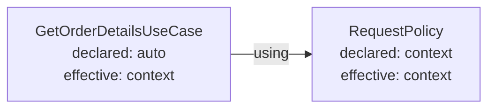

An Intent has no implementation dependencies. A Provider declares the Intents needed by one
particular realization through `using`.

That distinction is what allows the same Intent to have a direct in-memory realization in one
Composition and a database-backed realization in another.

## Declare local dependencies with `using`

Suppose `Orders` owns a private lookup seam and a public use case:

```ts
const FindOrderById = Orders.intent("findOrderById").contract<
  OrderId,
  Order,
  { readonly code: "not_found" }
>();

const GetOrderDetailsUseCase = Orders.intent("getOrderDetailsUseCase").contract<
  OrderId,
  Order,
  { readonly code: "not_found" | "forbidden" }
>();
```

The use-case Provider declares its dependency once:

```ts
type OrdersParams = {
  readonly role: "admin" | "viewer" | "guest";
};

const GetOrderDetailsProvider = GetOrderDetailsUseCase.provide
  .perContext<OrdersParams>()
  // FindOrderById is a dependency
  .using({ findOrderById: FindOrderById })
  .with(({ deps: { findOrderById }, params, out }) => {
    return async function getOrderDetails(id) {
      if (params.role === "guest") {
        return out.expectedError({ code: "forbidden" });
      }

      return findOrderById(id);
    };
  });
```

The key `findOrderById` is local to this realization. Forma infers the resolved operation from the
`FindOrderById` Contract; the Provider does not repeat its function type.

For a Boundary-originated Provider, every Intent in `using` must belong to that same Boundary. This
keeps cross-Boundary knowledge out of its realization. An Adapter can depend on Intents from any
Boundary because connecting those languages is its responsibility.

`using` is one-shot. Put all dependencies in one object:

```ts
SomeIntent.provide.using({ first: FirstIntent, second: SecondIntent }).with(/* ... */);
```

There is no public resolver and no ambient container lookup. The factory can only use the
operations it declared.

## Lazy by Surface branch

`compose()` validates and compiles the complete graph, but it does not run Provider factories.
Materialization begins when a Surface operation is first used.

For the first call to `getOrderDetails`, Forma:

1. resolves the Provider registered for `FindOrderById`;
2. materializes that Provider and its transitive dependencies;
3. supplies the resolved `findOrderById` operation to `GetOrderDetailsProvider`;
4. materializes and caches the `getOrderDetails` operation;
5. invokes it.

Unused Surface branches remain unmaterialized. Inside the selected branch, however, declared
`using` dependencies are materialized before the consumer factory runs. The factory cannot inspect
the input and then decide which declared dependency to construct. It may decide which resolved
operation to invoke, but the dependency subtree is already available by then.

Concurrent first callers within the same owner share one in-flight materialization Promise. A
Provider factory is not duplicated by a first-access race.

## Declared and effective lifetime

A Provider declares a policy. The Composition derives its effective owner from the resolved graph.

| Declaration          | Meaning                                                                            |
| -------------------- | ---------------------------------------------------------------------------------- |
| no modifier (`auto`) | Use the longest lifetime compatible with all transitive dependencies               |
| `.perContext()`      | Always owned by one Execution context                                              |
| `.perComposition()`  | Always owned by the Composition root; fail if the graph requires context ownership |

With the current two owners:

```text
auto + no context dependency       → composition
auto + transitive context dependency → context
perContext                         → context
perComposition                     → composition or compose-time conflict
```

If an `auto` Provider depends on a `.perContext()` Provider, context ownership propagates to the
consumer. This prevents a root-owned operation from capturing a dependency owned by one particular
Execution context.



An explicit `.perComposition()` pin makes shared identity and setup frequency part of the design.
If a transitive dependency is context-owned, `compose()` fails with the causal Intent path instead
of silently narrowing the pinned Provider.

`root.describePlan()` exposes declared and effective lifetimes, including the path that narrowed an
`auto` Provider.

## Context Params

`.perContext<Params>()` may declare data that the host must supply when opening the Execution
context:

```ts
const root = compose({
  entryBoundaries: [Orders],
  surface: { getOrderDetails: GetOrderDetailsProvider },
  wiring: [FindOrderByIdProvider],
});

await root.withExecutionContext((surface) => surface.getOrderDetails("42"), {
  params: { role: "viewer" },
});
```

`compose` merges Params requirements from all registered `.perContext<...>()` Providers. Conflicting
types for the same key fail at composition. The inferred root then requires the merged bag on
`openExecutionContext` and `withExecutionContext`.

At runtime, the outer bag must be a plain object with `Object.prototype` or `null` prototype and
only own, enumerable, string-keyed data properties. Forma rejects arrays, functions, class
instances, built-ins, accessors, symbols, non-enumerable properties, and `__proto__`.

Forma clones the validated outer bag and shallow-freezes that copy. Nested values are neither
validated nor frozen. The execution handle and all declared per-context factories receive the same
normalized copy.

An `auto` Provider narrowed to context ownership does not automatically gain access to Params. Only
a Provider that explicitly declared `.perContext<Params>()` receives `ctx.params`.

Use `compose<ExplicitParams>()({...})` only when the host intentionally supplies a typed superset
of the inferred bag:

```ts
type HostParams = OrdersParams & {
  readonly traceId: string;
};

const root = compose<HostParams>()({
  entryBoundaries: [Orders],
  surface: { getOrderDetails: GetOrderDetailsProvider },
  wiring: [FindOrderByIdProvider],
});
```

## Acquire and dispose resources in the factory

The factory receives `lifetime.signal` and `lifetime.onDispose` for the Provider instance being
materialized:

```ts
import { DatabaseSync } from "node:sqlite";

const Database = Sqlite.intent("database").contract<void, DatabaseSync, never>();

const DatabaseProvider = Database.provide.perComposition().with(({ lifetime, out }) => {
  const database = new DatabaseSync(":memory:");

  lifetime.onDispose(() => database.close());

  return function getDatabase() {
    return out.success(database);
  };
});
```

`DatabaseSync` is a portability trade-off of the runnable demo: Node's built-in `node:sqlite`
interface is synchronous. Forma can equally materialize an asynchronous database pool, a Worker
Thread-backed resource, or a remote client.

Provider factories themselves may be asynchronous:

```ts
const SnapshotProvider = Snapshot.provide.perComposition().with(async ({ lifetime, out }) => {
  const snapshot = await loadSnapshot({ signal: lifetime.signal });
  lifetime.onDispose(() => snapshot.close());

  return function readSnapshot(query) {
    return out.success(snapshot.read(query));
  };
});
```

Cleanups registered during materialization remain local until the factory succeeds. Success commits
them to the selected owner. If the factory throws, rejects, or loses a race with disposal, Forma
runs those cleanups immediately as rollback and does not cache the failed attempt.

`onDispose` registration is valid only during the materialization attempt. Once the factory
settles, the Lifetime is sealed.

## Cleanup order and failures

Provider cleanups run in reverse registration order. Forma attempts all of them:

- one failure is rethrown;
- multiple failures become an `AggregateError`;
- a factory failure combined with rollback failure becomes a `SuppressedError`, preserving the
  factory failure as the primary error.

Cleanup failures are lifecycle failures. They reject disposal and are not converted into an
Intent's `InvocationOutcome`.

Next, use an [Adapter](/v0/application-architecture/forma/adapters-and-evolution/) to realize the
local `FindOrderById` seam through another Boundary.
