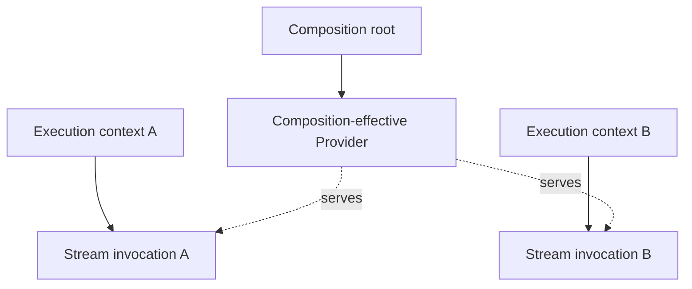

A stream is not a unary Intent whose successful value happens to be an `AsyncIterable`. It has a
different invocation lifetime: the Surface call returns before iteration begins, and the iterator
may remain active until the consumer, context, or root closes it.

Forma therefore models streaming as a Contract modality.

## Declare a Stream Intent

```ts
type OrderId = string;
type OrderEvent = {
  readonly orderId: string;
  readonly status: "open" | "paid" | "shipped";
};
type WatchError = { readonly code: "not_found" };

const WatchOrderEventsUseCase = Orders.stream("watchOrderEventsUseCase").contract<
  OrderId,
  OrderEvent,
  WatchError
>();
```

Modality is fixed on the Contract:

- `boundary.intent` declares `unary`;
- `boundary.stream` declares `stream`.

Identity remains `(boundaryId, intentName)`. Adapters and Intent aliases must preserve modality.

## Implement a cold operation

The Provider factory returns a `StreamOperation`. An async generator is the usual implementation:

```ts
const orders = new Set(["42"]);
const statuses = ["open", "paid", "shipped"] as const;

const WatchOrderEventsProvider = WatchOrderEventsUseCase.provide.with(({ out }) => {
  return async function* watchOrderEvents(id, invocation) {
    if (!orders.has(id)) {
      yield out.expectedError({ code: "not_found" });
      return;
    }

    try {
      for (const status of statuses) {
        invocation.signal.throwIfAborted();
        yield out.success({ orderId: id, status });
      }
    } finally {
      console.log(`watchOrderEvents(${id}) closed`);
    }
  };
});
```

The second operation argument contains a signal for this particular stream invocation. It is
subordinate to the Execution-context signal and distinct from `lifetime.signal`, which belongs to a
materialized Provider instance.

## Consume it from the Surface

A stream Surface call returns synchronously:

```ts
AsyncIterable<InvocationOutcome<OrderEvent, WatchError>> & AsyncDisposable;
```

Consume it with `for await`:

```ts
await root.withExecutionContext(async (surface) => {
  for await (const outcome of surface.watchOrderEvents("42")) {
    switch (outcome.kind) {
      case "success":
        console.log(outcome.value.status);
        break;
      case "expectedError":
        console.log(outcome.error.code);
        return;
      case "unexpectedFailure":
        console.error(outcome.failure.id);
        return;
      case "cancelled":
        return;
    }
  }
});
```

Creating the iterable does not materialize the Provider, acquire execution ownership, or start the
source. The first `next()` does.

## Cold and single-consumer

Each Surface call creates an independent cold stream value. One value may be iterated only once,
and concurrent `next()` calls on that same value are rejected.

```ts
const first = execution.surface.watchOrderEvents("42");
const second = execution.surface.watchOrderEvents("42");

// Independent invocations.
await Promise.all([consume(first), consume(second)]);
```

If the parent signal is already aborted at the first `next()`, the cold stream completes without
materializing the Provider or invoking the source.

## Outcome protocol

Stream events use the same four kinds as unary Intents:

- `success` is repeatable;
- `expectedError` is terminal;
- `unexpectedFailure` is terminal;
- `cancelled` is terminal;
- natural iterator completion is a correct end without a terminal yield.

After delivering the first terminal event, Forma calls `return()` on the source so later yields are
not observable and generator `finally` blocks can run.

A source throw or rejection during start or `next()` becomes a terminal `unexpectedFailure` event.
It does not reject `next()` for that implementation failure. The Composition diagnostic hook is
notified once at the origin.

Cleanup failures remain exceptional: a generator `return()` or `finally` failure can still reject
the close or owner disposal path.

## Invocation ownership

Every accepted stream invocation belongs to the Execution context that started it, regardless of
the Provider's effective lifetime.



The Provider may be shared by the root while each open iterator, signal, and cleanup remains owned
by its context.

An accepted start is transactional. Forma records ownership before scheduling the source. If start
acceptance fails, the source is not invoked and partial ownership is released through the normal
close path. If a close races with start, it waits for any produced iterator and calls `return()`
exactly once.

## Ways a stream closes

Forma closes an active stream on:

- natural completion;
- consumer `break` or `return()`;
- iterable `[Symbol.asyncDispose]`;
- parent signal abort;
- Execution-context disposal;
- Composition-root disposal.

Closing aborts the per-stream signal, calls source `return()`, awaits `finally`, and releases
ownership once. Concurrent close attempts share the same close Promise.

One stream's cancellation does not abort sibling streams or the entire Execution context.

For explicit ownership outside `for await`, use the iterable itself as an async disposable:

```ts
await using stream = execution.surface.watchOrderEvents("42");

for await (const event of stream) {
  if (event.kind === "success") {
    console.log(event.value);
    break;
  }
}
```

Forma does not impose a timeout on a non-cooperative source. The source must observe its signal or
otherwise make progress toward `return()` completion.

## Streams as dependencies

`using` a Stream Intent resolves to its operation, not to an already-open iterator. Calling the
operation creates a new invocation:

```ts
const WatchOrderEventsProvider = WatchOrderEventsUseCase.provide
  .using({ events: FindOrderEventsByOrderId })
  .with(({ deps: { events } }) => {
    return function watchOrderEvents(id, invocation) {
      return events(id, invocation);
    };
  });
```

The Surface wrapper still owns the public invocation. Adapters use the same stream builder and must
pass the invocation signal through when delegating.

## Backpressure and scope

Async iteration is pull-based: the source produces the next item in response to consumer demand.
Forma preserves that protocol and does not add buffering, multicast, replay, reconnect, duplex
transport, or Observable semantics.

Remote transports such as SSE or WebSocket can adapt the same operation protocol, but framing,
reconnection, and network policy remain outside the core.

The SQLite demo reads its small result set synchronously and then yields validated rows. It
demonstrates Forma's stream Contract and lifecycle, not non-blocking database streaming. An async
driver or Worker-backed Provider can use the same Intent and ownership model.

See [Inspection and testing](/v0/application-architecture/forma/inspection-and-testing/) for ways
to verify stream modality, origin, lifetime, and cleanup through the public Composition API.
